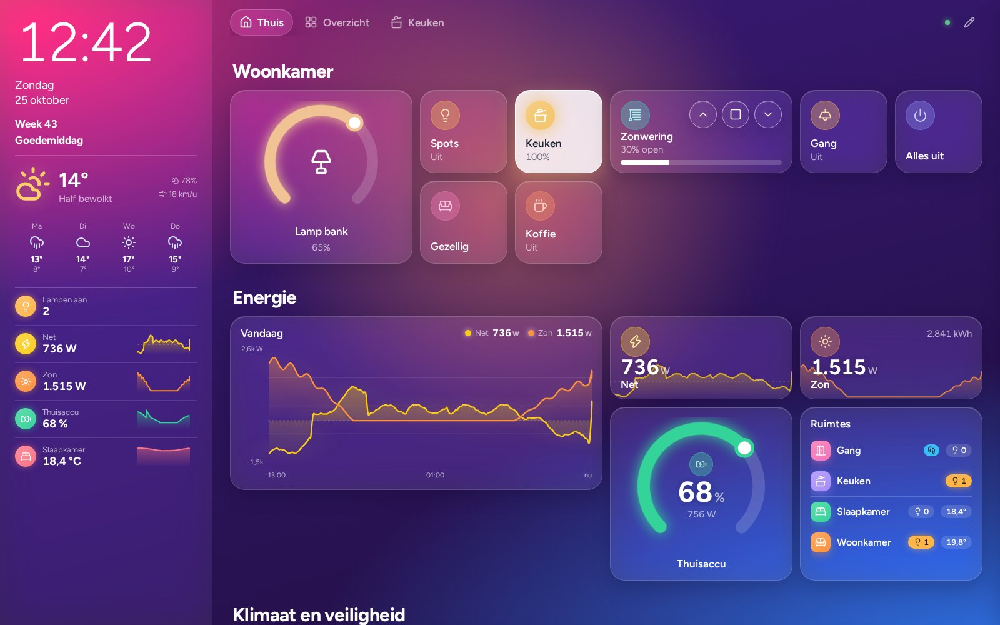
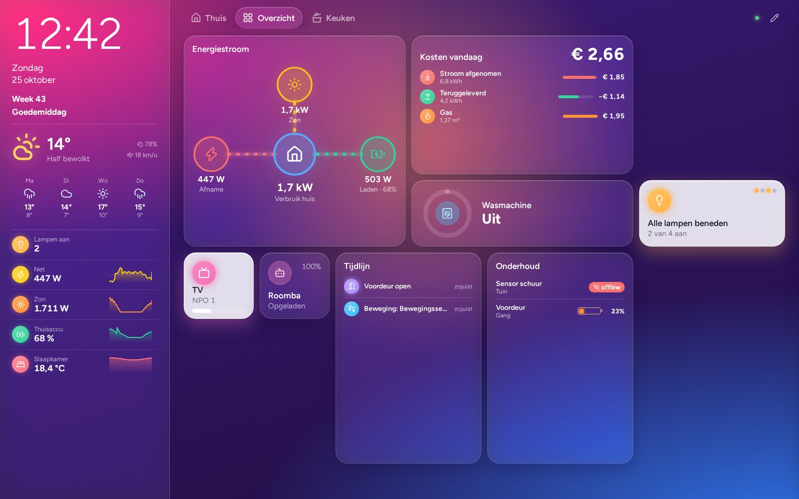
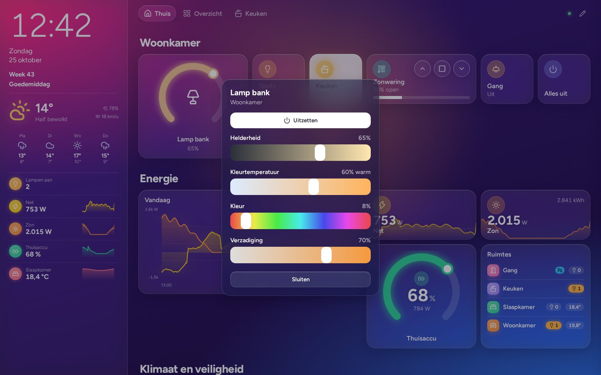
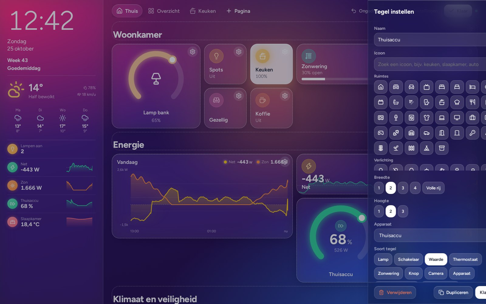
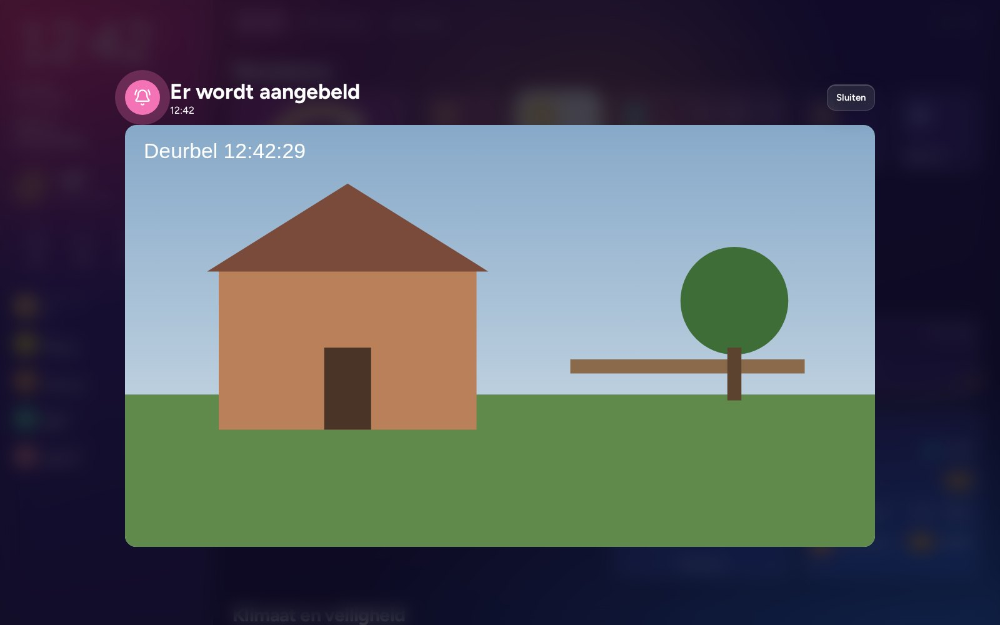
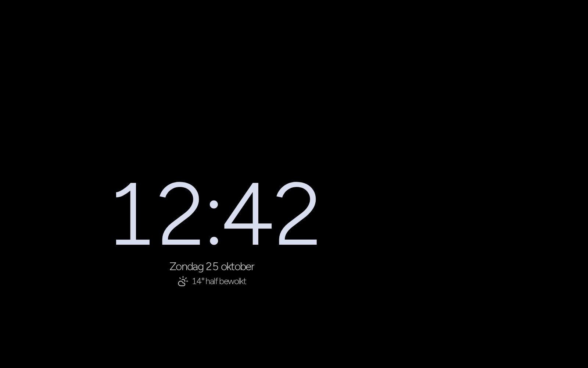
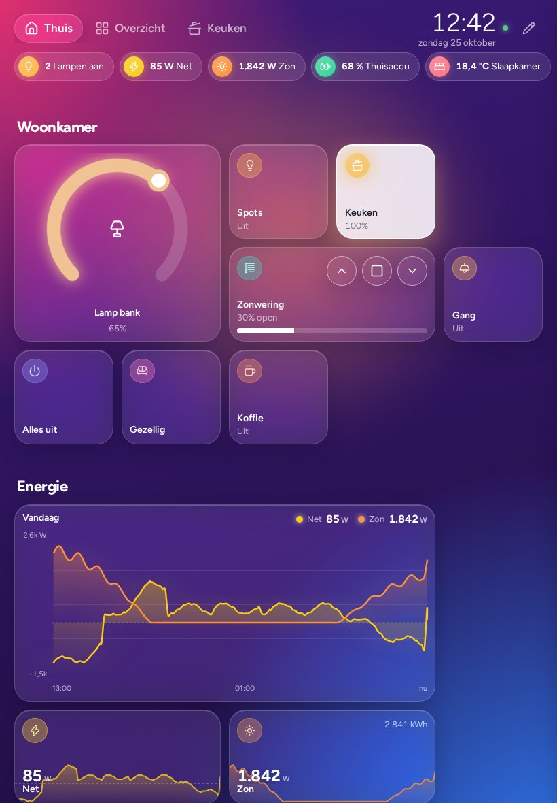
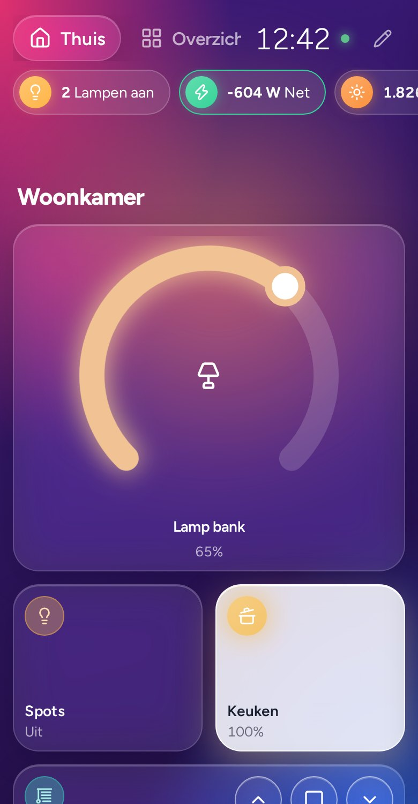

<div align="center">

# Homey tablet-dashboard

**Een zelfgehost wanddashboard voor Homey Pro dat je op het scherm zelf indeelt.**




</div>

Tegels toevoegen, verslepen, groter maken en instellen doe je allemaal op de tablet, zonder code. De indeling past zich aan elk scherm aan, van telefoon tot liggende of staande tablet. Waarden komen live binnen via de lokale Web API van de Homey, zonder cloud.

## Inhoud

- [Wat het kan](#wat-het-kan)
- [Screenshots](#screenshots)
- [Installeren](#installeren)
- [Instellingen in .env](#instellingen-in-env)
- [Koppelingen](#koppelingen)
- [Tablet instellen](#tablet-instellen)
- [Uitproberen zonder Homey](#uitproberen-zonder-homey)
- [Hoe het in elkaar zit](#hoe-het-in-elkaar-zit)

## Wat het kan

| | |
|---|---|
| 🎛️ **Bewerken op het scherm** | Tegels toevoegen uit je Homey-apparaten, flows en moods, verslepen, van grootte veranderen en per tegel instellen. Met ongedaan maken, pincode en export/import. |
| 💡 **Lampen die gloeien** | Een brandende lamp kleurt zijn tegel in de echte lichtkleur. Lang indrukken opent helderheid, kleurtemperatuur en kleur. |
| ⚡ **Energie** | Een geanimeerde energiestroom met zon, net, thuisaccu en huis, grafieken tot 30 dagen, boogmeters, kosten van vandaag en de verwachte jaarnota. |
| 📷 **Camera's** | Momentopnames via Homey, live beeld via go2rtc, en een deurbel-pop-up met belgeluid die over alles heen verschijnt. |
| 🏠 **Huis in één oogopslag** | Ruimtes met lampen en temperatuur, aanwezigheid, een tijdlijn van wat er gebeurde, batterijen die bijna leeg zijn, en de afvalkalender. |
| 🧺 **Apparaten** | Wasmachine, droger, vaatwasser en 3D-printer met voortgangsring en een melding als ze klaar zijn. |
| 🚨 **Alarm** | Waterlek, rook of koolmonoxide geeft een groot rood scherm met geluid. |
| 🌙 **Dag en nacht** | De achtergrond kleurt mee met het tijdstip. 's Nachts dimt het scherm of toont het een klok, een dagoverzicht of een fotolijst. Per tijdvak kies je een andere startpagina. |

## Screenshots

<table>
<tr>
<td width="50%"><br><sub><b>Energiestroom en overzicht.</b> Stroom van zon, net en accu, kosten van vandaag, een wasmachine die klaar is, de tijdlijn en batterijen die bijna leeg zijn.</sub></td>
<td width="50%"><br><sub><b>Lamp bedienen.</b> Lang indrukken opent helderheid, kleurtemperatuur en kleur.</sub></td>
</tr>
<tr>
<td><br><sub><b>Bewerkmodus.</b> Elke tegel heeft eigen instellingen: icoon, grootte, weergave, drempelkleuren en meer.</sub></td>
<td><br><sub><b>Deurbel.</b> Bij aanbellen verschijnt een groot (live) beeld met belgeluid.</sub></td>
</tr>
<tr>
<td><br><sub><b>Schermbeveiliging.</b> 's Nachts een rustige klok met het weer, die langzaam verschuift tegen inbranden.</sub></td>
<td>

<br><sub><b>Elk scherm.</b> Staand, liggend of op de telefoon: de kolommen passen zich vanzelf aan.</sub>
</td>
</tr>
</table>

## Installeren

Je hebt een server met Docker nodig (een NAS, mini-pc of Raspberry Pi) in hetzelfde netwerk als je Homey Pro.

**1. Maak een API-sleutel in Homey.** Ga in de Homey web-app ([my.homey.app](https://my.homey.app)) naar **Instellingen → API-sleutels** en geef de sleutel deze rechten:

- apparaten en zones bekijken, apparaten bedienen
- flows bekijken en starten, moods gebruiken
- gebruikers bekijken (voor de aanwezigheidstegel)
- apps (voor de afvalkalender uit Trashcan Reminder)

**2. Haal de bestanden op en vul de instellingen in.**

```bash
git clone https://github.com/rikadoo/homey-dashboard.git
cd homey-dashboard
cp .env.example .env
cp go2rtc/go2rtc.example.yaml go2rtc/go2rtc.yaml
nano .env          # vul minstens HOMEY_ADDRESS en HOMEY_TOKEN in
```

**3. Start.**

```bash
docker compose up -d --build
docker compose logs -f homey-dashboard
```

In de log verschijnt `Verbonden, N apparaten gevolgd`. Open daarna `http://<server>:8091`.

> [!TIP]
> Liever niet zelf bouwen? Gebruik het kant-en-klare image. Zet in `docker-compose.yml` een `#` voor `build: .`, haal het `#` weg voor `image: ghcr.io/rikadoo/homey-dashboard:latest` en draai `docker compose pull && docker compose up -d`.

**Bijwerken:** `git pull && docker compose up -d --build`. Je indeling, geschiedenis en instellingen staan in `data/` en `.env` en blijven bewaard.

> [!IMPORTANT]
> De server moet de Homey kunnen bereiken op poort 80. Staat de Homey in een apart IoT-netwerk, sta dat verkeer dan toe in je firewall.

## Instellingen in .env

| Instelling | Verplicht | Wat het doet |
|---|:---:|---|
| `HOMEY_ADDRESS` | ✅ | Adres van je Homey Pro, bijvoorbeeld `http://192.168.1.50` |
| `HOMEY_TOKEN` | ✅ | De API-sleutel uit stap 1. Leeg laten start de demo-modus. |
| `EDIT_PIN` | | Pincode om de bewerkmodus te openen |
| `ALLOWED_NETWORKS` | | Alleen toegang vanaf deze netwerken, bijvoorbeeld `192.168.1.0/24` |
| `DASH_USER`, `DASH_PASS` | | Inloggen met gebruikersnaam en wachtwoord, één keer per apparaat |
| `TRUST_PROXY` | | Zet op `1` achter een reverse proxy zoals Traefik |
| `ENERGY_URL` | | Adres van een energiedashboard, voor de tegel "Energie vandaag" |
| `BACKUP_DIR` | | Map voor een dagelijkse back-up van de indeling |
| `PHOTOS_DIR` | | Map met foto's voor de fotolijst |

Alles wat je op het scherm instelt (indeling, thema, weer, deurbel, schermbeveiliging) staat in `data/layout.json`, niet in `.env`.

## Koppelingen

<details>
<summary><b>Live camerabeeld (go2rtc)</b></summary>

Homey levert van camera's meestal alleen momentopnames. Voor live beeld start `docker compose` ook **go2rtc**, dat de RTSP-streams omzet naar beeld voor de browser.

1. Zet bij je camera's RTSP aan. Bij UniFi Protect: camera → Instellingen → Geavanceerd → RTSP(S) → "Gemiddeld".
2. Zet de adressen in `go2rtc/go2rtc.yaml`, zoals in dat bestand uitgelegd.
3. Test op `http://<server>:1984`: klik bij een stream op "stream".
4. Vul bij de camera-tegel de streamnaam in. Tikken opent dan live beeld, ook in de deurbel-pop-up.

Open je het dashboard via https, maak dan ook voor go2rtc een https-route en vul dat adres in bij Instellingen. go2rtc heeft zelf geen wachtwoord, dus houd die route intern.

</details>

<details>
<summary><b>Afvalkalender</b></summary>

De afvaltegel haalt de ophaaldagen uit de Homey-app **Trashcan Reminder** (com.trashchecker). Er hoeft niets ingevuld te worden. Heeft je gemeente een iCal-link, dan kun je die bij Instellingen invullen; die gaat dan voor.

</details>

<details>
<summary><b>Energiedashboard</b></summary>

De tegel "Energie vandaag" en de schermbeveiliging "Overzicht" tonen opwek, verbruik, zelfvoorzienendheid, kosten en de verwachte jaarnota uit een energiedashboard. Zet het adres in `ENERGY_URL`. Draaien beide containers in hetzelfde Docker-netwerk, dan werkt de containernaam als adres, bijvoorbeeld `http://energie-dashboard:8080`.

</details>

<details>
<summary><b>Traefik</b></summary>

```yaml
http:
  routers:
    homey-dashboard:
      rule: "Host(`dashboard.example.nl`)"
      entryPoints: [websecure]
      tls: {}
      service: homey-dashboard
  services:
    homey-dashboard:
      loadBalancer:
        servers:
          - url: "http://homey-dashboard:8080"
```

WebSockets werken zonder extra instellingen. Zet `TRUST_PROXY=1` in `.env`.

</details>

<details>
<summary><b>Monitoring en back-ups</b></summary>

- `/health` geeft status 200 als de Homey verbonden is en 503 als dat niet zo is. Docker gebruikt dit zelf, en je kunt het in Uptime Kuma zetten.
- Met `BACKUP_DIR` wordt elke dag een kopie van de indeling gemaakt; de laatste 30 blijven bewaard. Daarnaast staan de laatste 20 versies in `data/backups/`.
- Grafieken worden bij de start aangevuld uit Homey Insights, zodat ze meteen gevuld zijn.

</details>

## Tablet instellen

- **Android:** gebruik [Fully Kiosk Browser](https://www.fully-kiosk.com) met de URL van het dashboard, en zet "Keep screen on" en "Launch on boot" aan.
- **iPad:** open de pagina in Safari, kies "Zet op beginscherm" en gebruik Begeleide toegang om het scherm vast te zetten.
- **Trage tablet?** Zet bij Instellingen "Minder vervaging" aan. Dat scheelt veel rekenkracht.

Het dashboard is te installeren als app. Als de server even weg is, verschijnt een rode melding en herstelt de pagina zichzelf.

## Uitproberen zonder Homey

```bash
npm install
npm run demo
```

Open `http://localhost:8080`. Je krijgt een demo-indeling met nep-apparaten die live veranderen; de screenshots hierboven komen daaruit.

## Hoe het in elkaar zit

| Bestand | Wat het doet |
|---|---|
| `server.js` | Webserver, opslag van de indeling, WebSocket voor live updates |
| `lib/homey.js` | Verbinding met de Homey via de lokale Web API |
| `lib/history.js` | Geschiedenis voor grafieken, aangevuld uit Homey Insights |
| `lib/events.js` | Tijdlijn, apparaten die klaar zijn, deurbel |
| `lib/energy.js`, `lib/waste.js`, `lib/weather.js` | Energiedashboard, afvalkalender en weer (Open-Meteo) |
| `lib/security.js` | Toegang per netwerk en inloggen |
| `lib/mock.js` | Demo-apparaten voor uitproberen zonder Homey |
| `public/app.js` | Tegels, bediening en de bewerkmodus |
| `public/graphics.js` | Grafieken, meters, zijpaneel en statusbalk |
| `public/extras.js` | Energiestroom, apparaten, groepen, deurbel, schermbeveiliging en meer |
| `public/live.js` | Live camerabeeld via go2rtc |
| `public/style.css` | Uiterlijk; de kleuren staan bovenaan als variabelen |

Een eigen tegeltype voeg je toe in `TYPES`: elk type heeft een `render`-functie en optioneel `tap`, `hold`, `settings` en `onInput`.

**Gebouwd met** [homey-api](https://github.com/athombv/node-homey-api), [Express](https://expressjs.com), [ws](https://github.com/websockets/ws), [SortableJS](https://sortablejs.github.io/Sortable/), [Lucide](https://lucide.dev)-iconen, het lettertype [Figtree](https://fonts.google.com/specimen/Figtree), weer van [Open-Meteo](https://open-meteo.com) en [go2rtc](https://github.com/AlexxIT/go2rtc).

## Licentie

GPL-3.0, zie [`LICENSE`](LICENSE). Het dashboard gebruikt de officiële bibliotheek `homey-api` van Athom, die ook onder GPL-3.0 valt.
